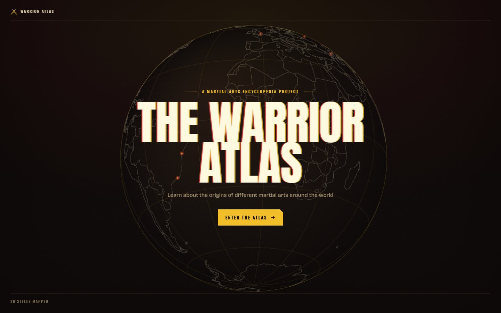
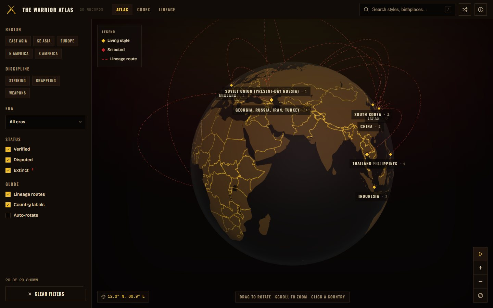
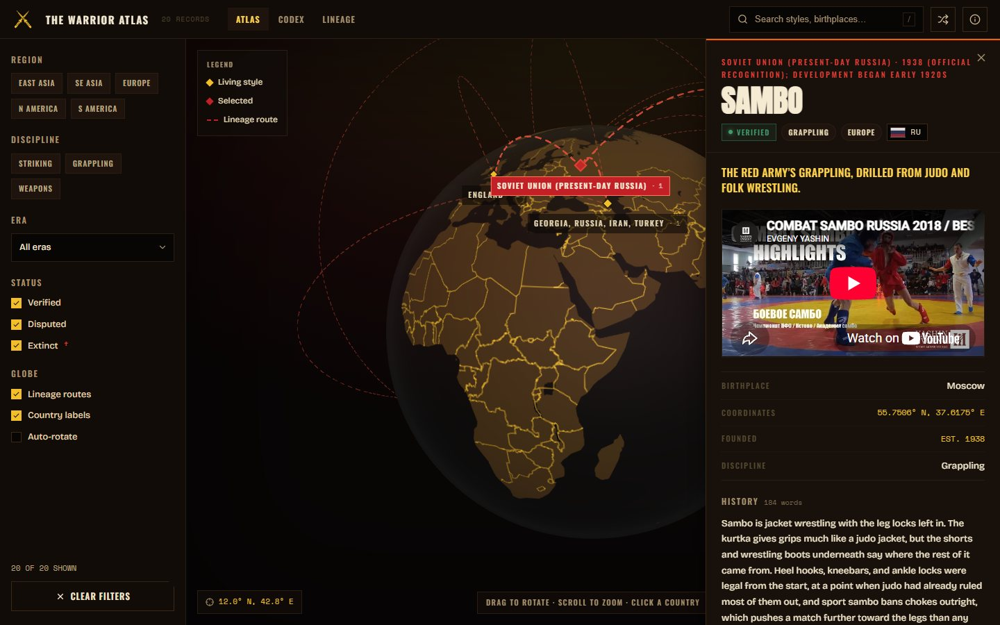
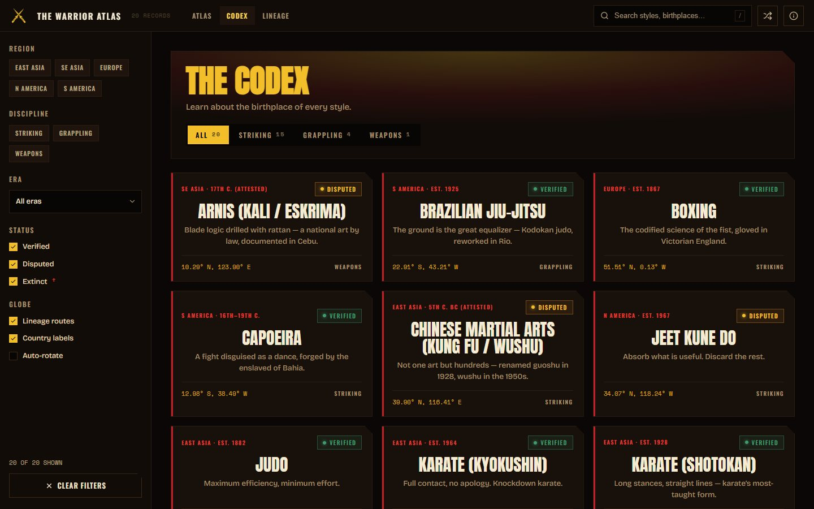
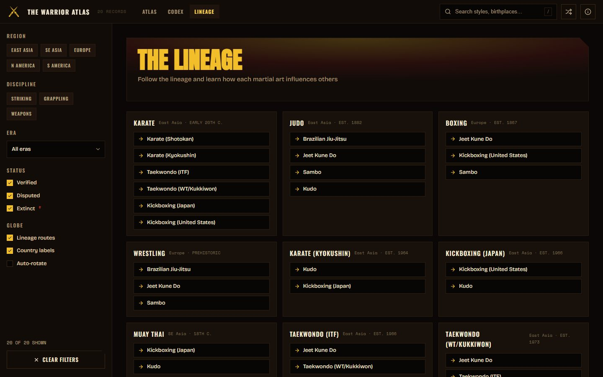
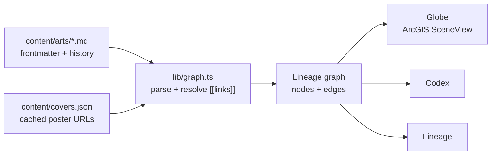

# The Warrior Atlas

A 3D globe that maps where the world's martial arts were born and how they influenced each other. Built on Esri's ArcGIS Maps SDK for JavaScript.

**Live:** [projectwarrioratlas.com](https://projectwarrioratlas.com)



I grew up fascinated by martial arts, both the fighting and the history behind it. I always liked tracing how one style came out of another: judo feeding into Brazilian jiu-jitsu, muay thai into kickboxing, karate splitting into a handful of schools. This project puts that family tree on a real globe.

## What it does

Spin the globe and every country with a native style gets a marker. Dashed arcs connect each style to the ones it influenced.



Click a country to open a dossier: where the style started, when, what it grew out of, a short history, and a strip of films and anime that feature it.



There are two other views. The **Codex** is a filterable grid of all 20 styles, and the **Lineage** view lays the influence graph out as a list.

| Codex | Lineage |
|---|---|
|  |  |

## How it's built

Each martial art is a markdown file in `content/arts/`. The frontmatter holds the facts (country, coordinates, founding year) and links to other styles with `[[wikilinks]]`. At build time a parser turns those files into a graph, and the globe draws it.



A record looks like this:

```yaml
---
name: Judo
country: Japan
lat: 35.7076
lng: 139.7534
founded: 1882
lineage: [[jujutsu]]
influenced: [[sambo]], [[bjj]], [[kudo]]
notable_media:
  - title: Sanshiro Sugata
    type: film
---
```

Links to styles that don't have their own file yet (like `[[jujutsu]]`) still show up in the dossier as text, but no arc gets drawn for them.

I wrote the history for each style myself, then ran a retrieval-augmented agent workflow: agents queried the Wikidata API to ground each style's origins and influences in sourced data, and pulled poster art from AniList, TMDB and iTunes. The poster URLs are cached in `content/covers.json`, so the build never calls an outside API. [`docs/ADDING-ARTS.md`](docs/ADDING-ARTS.md) covers how to add a new style.

## Stack

| | |
|---|---|
| Framework | Next.js 15, React 19, TypeScript |
| Globe | ArcGIS Maps SDK for JavaScript 4.31 (`SceneView`, global mode) |
| Basemap | Esri Dark Gray Canvas vector tiles, recolored in code |
| Content | Markdown + frontmatter, parsed with `gray-matter` |
| Hosting | Vercel |

## Things that were harder than expected

**Making Esri's basemap match the design.** The stock dark basemap is neutral grey, which clashed with the warm palette. Instead of restyling the layer after it loads, the app fetches the style JSON, rewrites every paint color, drops the road and building layers, and hands the finished style to the layer. The tiles are Esri's. The colors are mine.

**Arcs that lift off the surface.** The geodesic helpers I tried draw lines flat on the ground. I wrote my own great-circle math so each lineage route arches above the globe.

**Labels that flickered.** Country names drawn as map text re-sorted against the land every frame while the globe turned, so they flickered. They're now HTML laid over the canvas.

**A globe that was half as tall as it should be.** The SDK ships no CSS by default, so its canvas fell back to the browser's default 300×150 aspect ratio and left a dead band under the globe at every screen size. I copied the four layout rules it needs from the SDK source rather than import a 340 kB theme for widgets the app never uses. `scripts/check-globe-fit.mjs` catches it if an SDK upgrade breaks those rules.

**An API key failure you can't see.** If the ArcGIS key is rejected, the app falls back to a public copy of the same basemap, and after recoloring the two look identical. `npm run check:basemap` reads Esri's error codes so a bad key shows up as a failure instead of passing quietly.
